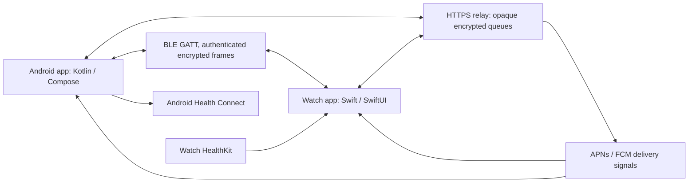

# Galaxy S25 Ultra ↔ Apple Watch Series 8 companion plan

Status: proposed implementation plan, 1 November 2026. User priority: both notifications and health. Working name: WatchBridge (name availability unverified).

## Objective and scope

Build an original Kotlin Android app and independent Swift/SwiftUI watchOS app that exchange notifications, supported replies, and health records. Target the user's actual S25 Ultra and Series 8 OS versions after checking them. The Merge analysis supplies architectural context; this implementation will use its own protocol, identifiers, code, UI, keys, and backend.

The watch remains activated through Apple's supported iPhone setup. WatchBridge supplies app-level communication with Android. A Mac/Xcode build/signing environment and appropriate Apple provisioning are prerequisites for watch installation. Those are deployment dependencies; Android and shared protocol work can proceed on Windows.

Unknown setup details: installed Android/One UI and watchOS versions; whether the watch is activated and paired; GPS versus cellular watch; access to iPhone, Mac, and Apple developer provisioning; preferred hosting. No hosting purchase or public deployment is part of this planning task.

## First version

| Capability | Planned behavior |
|---|---|
| Pairing | Short-lived pairing session, watch-displayed code, user confirmation on both devices, authenticated key exchange. |
| Notifications | Android app allowlist, watch inbox, title/body where permitted, timestamps, updates, removals, optional dismissal sync. |
| Replies | Preset text and watch text input routed to a still-valid Android RemoteInput action; show explicit failure if the source action expired. |
| Health | One-way HealthKit → Android Health Connect import: steps, heart-rate samples, active energy, sleep sessions/stages, workout summaries, subject to actual watch data availability. |
| Connection | Direct BLE when available plus encrypted queued HTTPS transport and push signaling. Clear last-connected and last-synced status. |
| Controls | Per-app forwarding, quiet hours, health type permissions, pause, unpair/revoke, local deletion, relay expiry. |

Later candidates: media controls, Wi-Fi credential sharing, richer workout metrics and routes. Call audio, Apple activation, cellular provisioning, ECG interpretation and complete Samsung Health parity are outside the first version. Call-state alerts can be evaluated after notifications are reliable.

## Architecture

Android hosts a BLE GATT peripheral service; watchOS acts as central. Start with three characteristic roles: capabilities/control, phone-to-watch events, and watch-to-phone events/acknowledgements. Actual characteristic properties and background monitoring are validated on Series 8 before freezing the protocol. Use fresh UUIDs. BLE link encryption is supplementary to application-layer encryption.

Android: Compose settings/inbox, NotificationListenerService, BLE transport service, Room durable outbox, WorkManager deferred sync, Health Connect writer, FCM receiver and diagnostics. Evaluate CompanionDeviceManager where it fits the topology; otherwise use a correctly scoped connected-device foreground service started within Android's rules. A persistent service is user-visible.

watchOS: independent SwiftUI app, CoreBluetooth central, notification categories/actions, local inbox and durable outbox, HealthKit authorization/queries, background URLSession transfers, APNs registration, and a small last-sync complication. It must recover after suspension rather than depend on continuous runtime.

Backend: small TypeScript service with PostgreSQL, HTTPS, per-device authentication, expiring ciphertext queues, bounded payloads/rates, acknowledgement cursors, device revocation, and APNs/FCM adapters. Docker Compose for local development. APNs credentials and push tokens stay server-side. Initial default retention: notification events up to 24 hours, health batches up to 7 days pending acknowledgement; delete acknowledged payloads. Retention is configurable.

## Feasibility gate: notifications while watch is asleep

This is the first engineering milestone, before a large UI or comprehensive health mapper. Apple permits Bluetooth alert/background work but imposes runtime budgets. Series 8 is within the hardware generation described by Apple's background BLE documentation; exact OS behavior still needs a physical-device test. Historic numeric quotas must not be assumed current.

Test foreground, wrist down, app suspended, Do Not Disturb, locked watch, Bluetooth out of range, Wi-Fi-only, and no internet. Record whether the app receives an event, whether watchOS displays an alert, latency, and battery impact separately. A transport acknowledgement is not proof of visible notification delivery.

Default private mode: encrypted notification content in the relay/inbox; a remote alert may say only “New phone notification” until the app decrypts it. Investigate whether approved watchOS APIs on the installed version can display decrypted content during available runtime. Do not assume an iOS notification-service extension can run on standalone watchOS.

If full-text background remote alerts cannot be achieved privately, make an explicit product choice after the test: retain generic alerts with encrypted inbox, or offer optional previews whose text is exposed to the push service/relay as disclosed. Do not silently downgrade privacy. Silent push delivery and background wakes are not a real-time guarantee.

## Protocol and security design

- Versioned protobuf messages defined by us: Pairing, Capabilities, NotificationUpsert/Remove, ReplyRequest/Result, HealthBatch/Ack, SyncCursor, Heartbeat and Revoke.
- Envelope: protocol version, sender/recipient device IDs, key epoch, message ID, sequence, creation time, expiry, event type and authenticated ciphertext. Authenticate routing fields as AEAD associated data. Enforce size limits before allocation.
- Use a maintained cross-platform cryptographic library and a reviewed authenticated pairing pattern. Candidate: ephemeral X25519, HKDF-SHA256, AES-256-GCM, with transcript-bound short authentication string confirmed on both screens. Select an implementation that interoperates with Android and CryptoKit before finalizing it. Do not invent cryptographic primitives or treat an unauthenticated ECDH exchange as secure pairing.
- Separate directional/session keys and persist nonce/counter state safely; rotate keys on reconnect/re-pair as designed. Define replay windows, acknowledgement deduplication, and restore/reinstall behavior.
- Store long-lived keys in Android Keystore and watch Keychain with deliberate lock/accessibility behavior. Expired queued replies and stale device credentials must fail closed.
- Relay stores ciphertext; device tokens, timings, routing and payload sizes remain metadata. Logs contain IDs and timings, not notification contents, Wi-Fi credentials or health payloads.
- BLE and relay share message IDs so fallback or retransmission cannot create duplicate inbox items, replies, or health records. Reply requests require short expiry and one-use action tokens.

## Notification implementation

1. Ask for notification access and select allowed source apps; forwarding defaults to a small explicit allowlist.
2. Normalize title/body/conversation metadata and source notification identity; sensitive/redacted content remains redacted. Initially omit large media attachments.
3. Coalesce updates and suppress duplicates. Keep source PendingIntent/RemoteInput objects only on Android; send opaque action handles to the watch.
4. Render a watch inbox with reply/dismiss actions. Revalidate the original Android action when a response arrives; report sent/expired/unsupported states accurately.
5. Separate received, decrypted, shown if observable, and action-executed states. Preserve user quiet hours and OS notification controls.

## Health synchronization

Use HealthKit observer notifications as scheduling hints, then anchored queries per record type to read additions/deletions. Persist query anchors only with a durable local outbox. First prove what the Series 8's HealthKit store actually exposes; it may not contain all historical data held by a paired iPhone.

Map records with explicit units, UTC timestamps, original zone offsets, source device and source record UUID. Use stable Health Connect clientRecordId values derived from source identity, and monotonically version changed records. Maintain a mapping for source deletions and app-owned Health Connect IDs. Never overwrite records created by unrelated apps.

Initial backfill: user-selected seven days, then incremental batches. Split batches to bounded sizes, resume after interruption, handle partially accepted records, and show counts plus last successful sync. Validate DST/time-zone changes, overlapping sleep stages, workout intervals, unit conversions, source duplication and revoked permissions.

Sync is one-way initially to avoid loops. Samsung Health visibility is a separate integration check: writing a record into Health Connect does not prove Samsung Health will display every type. A manually initiated “Sync now” remains available when background execution is delayed.

## Delivery milestones and acceptance

| Milestone | Deliverable | Acceptance gate |
|---|---|---|
| 0. Physical-device feasibility | Minimal phone/watch apps, BLE exchange, APNs signal, one HealthKit query and Health Connect write | Measure wrist-down/suspended behavior and document the notification privacy/delivery mode; verify real sample access. |
| 1. Secure pairing and transport | Authenticated device link, encrypted BLE frames, durable queues, reconnect/ack logic | Reject wrong pairing confirmation, replay and corrupted ciphertext; queued events survive process restart. |
| 2. Notifications | Allowlist, inbox, update/remove events, quick replies | Test source apps on the S25; each eligible reply executes once; expired actions visibly fail. |
| 3. Health | Five initial type families, seven-day backfill, incremental additions/deletions | Source fixture totals and timestamps match; repeated batches produce no duplicates; partial permission denial is handled. |
| 4. Internet fallback | Relay deployment candidate, APNs/FCM, queue expiry, revocation | Switch BLE↔internet, disconnect both devices, restore connectivity, verify no duplicate effects and correct expiry. |
| 5. Personal-use beta | Installable signed Android APK and provisioned watch build, setup guide, diagnostics | At least 48-hour physical-device run covering reboot, sleep, battery saver and network changes; measured battery and delivery report. |

Latency targets are provisional: under three seconds for foreground/local notification transfer; report median and p95 background delays rather than promise an unsupported bound. Measure baseline battery use and bridge-enabled use under comparable workloads before selecting a battery acceptance threshold. Test per-app notification visibility under DND/lock settings separately from transport reliability.

Repository layout: `android/`, `watchos/`, `protocol/`, `server/`, `test-vectors/`, `docs/`. CI can build Android/server and validate shared message/crypto vectors; watch builds require a macOS runner/Xcode and signing setup. Do not publish or purchase hosting as part of the first prototype.

## Evidence and platform references

- Apple's independent-app model: [Creating independent watchOS apps](https://developer.apple.com/documentation/watchos-apps/creating-independent-watchos-apps).
- Watch background BLE opportunities/limits: [Using background tasks](https://developer.apple.com/documentation/watchkit/using-background-tasks), [Get timely alerts from Bluetooth devices](https://developer.apple.com/videos/play/wwdc2022/10135/). The latter's specific numerical quotas describe the OS release presented, not a guarantee for the user's version.
- Supported setup flow: [Set up your Apple Watch](https://support.apple.com/en-ie/109015); exact compatible iPhone/OS requirements depend on watchOS.
- Android connection lifecycle: [Communicate in the background](https://developer.android.com/develop/connectivity/bluetooth/ble/background), [Foreground service types](https://developer.android.com/develop/background-work/services/fgs/service-types).
- Android notification hooks: [Notification services](https://developer.android.com/reference/android/service/notification/package-summary), [RemoteInput](https://developer.android.com/reference/android/app/RemoteInput).
- Health import primitives: [HealthKit observer queries](https://developer.apple.com/documentation/healthkit/executing-observer-queries), [Reading HealthKit data](https://developer.apple.com/documentation/healthkit/reading-data-from-healthkit), [Write Health Connect data](https://developer.android.com/health-and-fitness/health-connect/write-data), [Synchronize data](https://developer.android.com/health-and-fitness/health-connect/sync-data).
- Notification-service-extension boundary: [Modifying notification content](https://developer.apple.com/documentation/usernotifications/modifying-content-in-newly-delivered-notifications) documents an iOS extension and does not establish independent-watch support.
- Architectural context includes a separate local static analysis of Merge. Third-party artifacts and that analysis are excluded from this repository. They do not prove our proposed app will work under real watchOS scheduling constraints.
